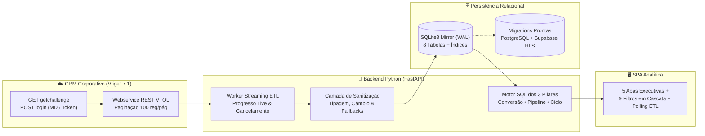
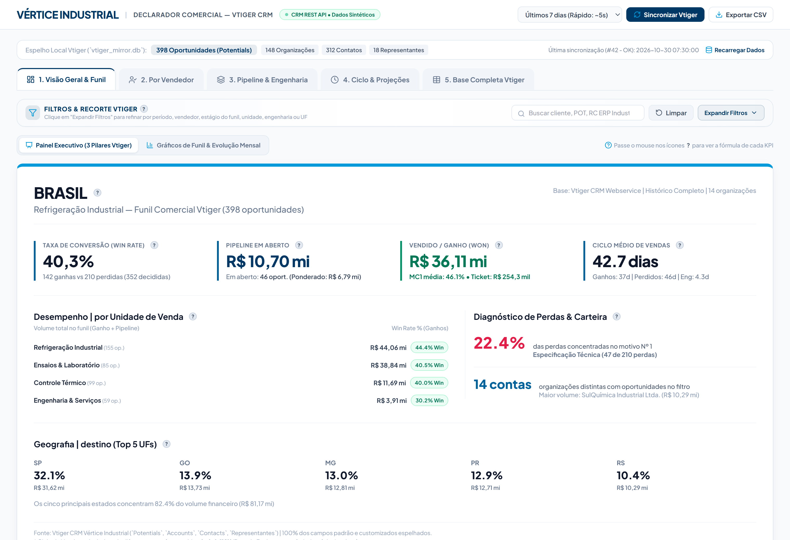
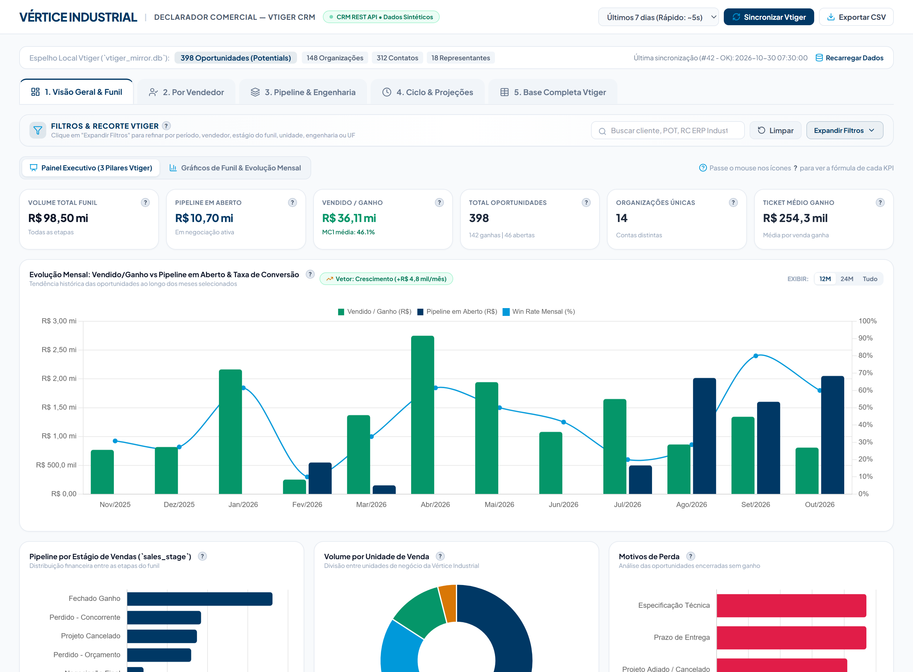
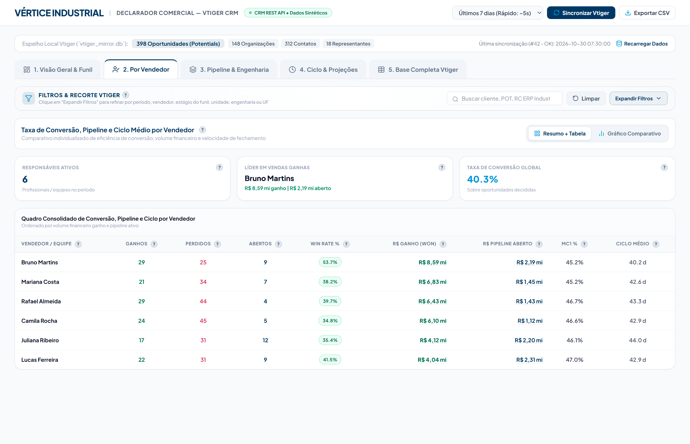
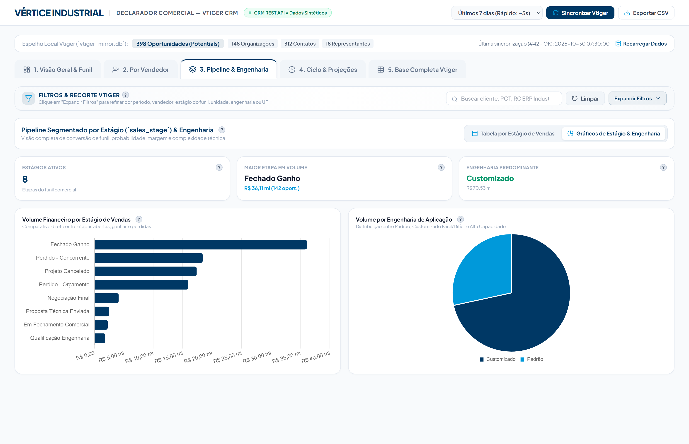
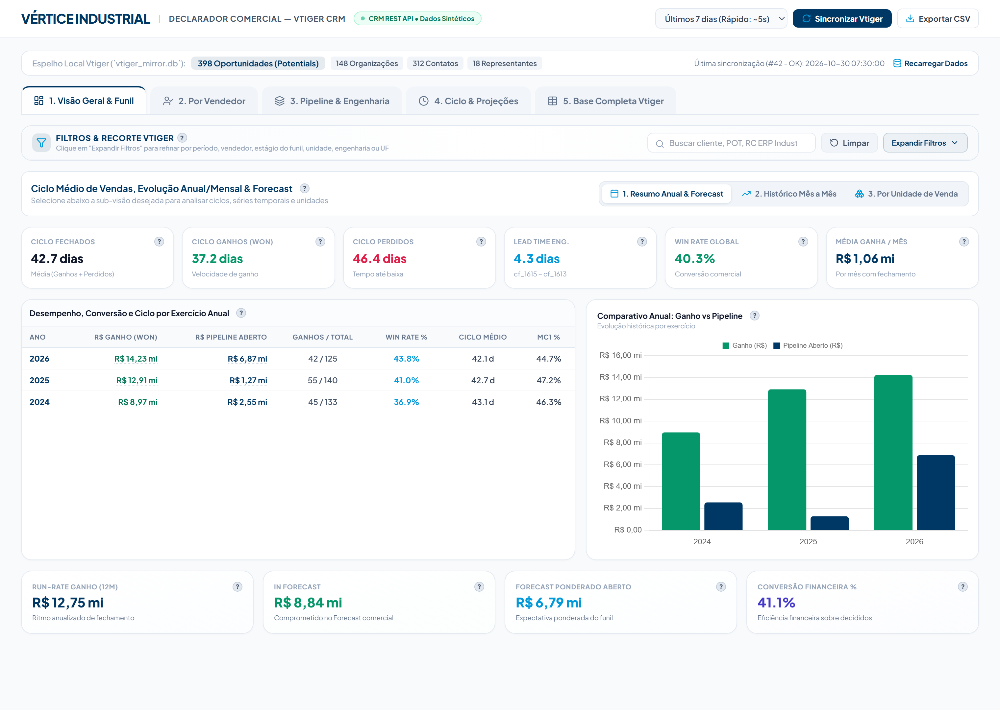
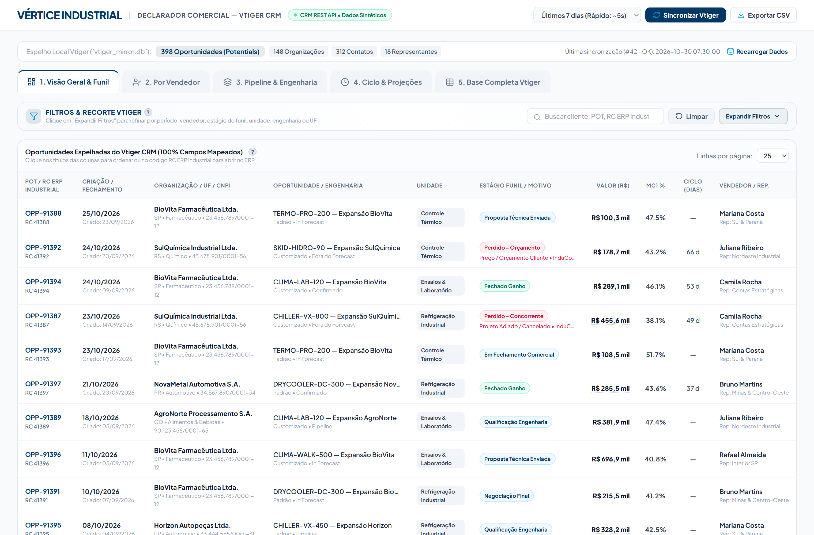

# 🎯 Declarador Comercial — Full-Stack CRM Analytics, Streaming ETL & Funil B2B


> **Estudo de Caso de Engenharia Full-Stack & Engenharia de Dados**  
> Plataforma analítica integrada via **Webservice REST API ao Vtiger CRM**, equipada com **motor de extração ETL em streaming página a página**, banco relacional espelhado local de altíssimo desempenho (`SQLite3 WAL`) e painel executivo interativo focado nos **3 Pilares de Eficiência Comercial**: *Taxa de Conversão (Win Rate)*, *Pipeline Ponderado* e *Velocidade do Ciclo de Vendas*.

🔗 **[Acessar Simulação Interativa Ao Vivo (GitHub Pages)](https://sambassoii.github.io/declarador-crm-analytics/)**  
🔗 **Projeto Complementar (Ecossistema Comercial):** [Relator Comercial — Motor de BI Executivo & Analytics Offline](https://github.com/SamBassoIi/relator-bi-comercial)

---

## 🛡️ Nota de Confidencialidade & Conformidade (LGPD / Segurança da Informação)

Este repositório foi estruturado especificamente como **Estudo de Caso de Portfólio e Demonstração Arquitetural**:
- **Proteção Integral de Segredos e Propriedade Intelectual:** Nenhuma credencial, URL interna, banco de dados real, regra comercial proprietária ou mapeamento interno corporativo está presente neste repositório ou em seu histórico Git.
- **100% Dados Sintéticos:** Todas as capturas de tela e a simulação interativa utilizam uma organização fictícia (*Vértice Industrial*), CNPJs fictícios e oportunidades geradas algoritmicamente para demonstrar a engenharia do sistema com segurança absoluta.

---

## 🎯 O Desafio Técnico & de Negócio

Enquanto sistemas ERP registram apenas o que já foi faturado, a inteligência competitiva de uma operação industrial B2B reside no **funil de orçamentos abertos e propostas perdidas no CRM**. Entretanto, consultar diretamente APIs legadas de CRM (como o Webservice REST do Vtiger 7.1) em tempo real para alimentar dashboards analíticos esbarra em limitações severas:
1. **Limites rígidos de paginação por requisição** (`LIMIT offset, 100`) em bases históricas com dezenas de milhares de oportunidades, contas e contatos.
2. **Latência elevada e expiração de sessão** durante consultas agregadas complexas.
3. **Permissões restritivas por módulo** na API do CRM (ex.: bloqueios `ACCESS_DENIED` em tabelas auxiliares de usuários) e inconsistências históricas de digitação cambial.

## 🏗️ Arquitetura da Solução (Full-Stack + Data Engineering)

Para superar esses gargalos, o **Declarador Comercial** desacopla a leitura analítica da API transacional do CRM por meio de um **Espelho Analítico Local (`Mirror Database`)** sincronizado sob demanda via *Streaming ETL*:



---

## ⚙️ Destaques de Engenharia

### 1. Autenticação Criptográfica Challenge-Response (`Vtiger REST`)
Implementação completa do fluxo em duas etapas (`getchallenge` seguido de `POST login` autenticado via hash `MD5(challengeToken + accessKey)`), com detecção automática de expiração de sessão e reconexão transparente durante cargas longas.

### 2. Pipeline ETL em Streaming com Telemetria em Tempo Real
- Extração contínua página a página com *commits* incrementais imediatos por lote, evitando alto consumo de RAM mesmo em cargas históricas superiores a **50.000+ oportunidades** e **70.000+ contatos**.
- *Worker* assíncrono em background monitorado via polling leve (`GET /api/v1/etl/progress`), alimentando um modal interativo com barra de progresso percentual, cronômetro, contadores por entidade e **cancelamento cooperativo seguro**.
- Estratégia resiliente de *fallback* (`Users -> Groups`) quando credenciais de leitura possuem escopo restrito no CRM.

### 3. Modelagem de Banco de Dados & Segurança (`SQLite WAL` + `PostgreSQL RLS`)
- **Leitura Sub-Milissegundo:** Configuração `PRAGMA journal_mode=WAL` e `PRAGMA foreign_keys=ON` com índices compostos nas colunas de filtragem temporal, estágio de funil e organização.
- **Pronto para Nuvem Multi-Tenant:** Scripts DDL de migração estruturados para PostgreSQL / Supabase com políticas explícitas de **Row Level Security (RLS)** e integridade referencial.

### 4. Os 3 Pilares de KPIs de Mercado
- **Pilar 1 — Eficiência de Conversão (*Win Rate*):** Cálculo estrito sobre oportunidades decididas $\left[\frac{\text{Ganhos}}{\text{Ganhos} + \text{Perdidos}}\right]$ global, por unidade de negócio e por vendedor, acompanhado de diagnóstico dos motivos de perda e concorrentes.
- **Pilar 2 — Pipeline Financeiro & Forecast Ponderado:** Consolidação do funil aberto por estágio comercial e complexidade de engenharia, ponderando valores pela probabilidade de fechamento.
- **Pilar 3 — Velocidade do Funil (*Sales Cycle & Engineering Lead Time*):** Medição em dias corridos entre abertura e fechamento comercial (separando ciclos de propostas ganhas vs. perdidas) e tempo de resposta da engenharia de aplicação.

---

## 🖥️ Galeria de Telas (Ambiente Simulado — Dados 100% Sintéticos)

### 1. Lâmina Executiva — Os 3 Pilares do Funil CRM
Visão consolidada de *Win Rate*, *Pipeline em Aberto (Bruto e Ponderado)*, *Vendido/Ganho com MC1 média*, *Ciclo Médio em dias*, desempenho por unidade e diagnóstico do principal motivo de perda.


### 2. Evolução Mensal Combinada, Pipeline por Estágio & Motivos de Perda
Gráfico misto (*Vendido/Ganho vs. Pipeline Aberto + curva de Win Rate Mensal %*), vetor estatístico OLS e ranking de causas de perda comercial.


### 3. Conversão, Pipeline Ativo & Ciclo por Vendedor
Comparativo individualizado de eficiência comercial cruzando oportunidades ganhas, perdidas, em aberto, *Win Rate %*, margem média e velocidade de fechamento.


### 4. Segmentação de Pipeline & Complexidade de Engenharia
Distribuição financeira por etapa do funil de vendas e proporção entre projetos de engenharia padrão vs. customizados.


### 5. Velocidade Comercial, Lead Time de Engenharia & Forecast Anual
Indicadores dedicados de tempo de ciclo, comparativo histórico interanual e cartões de *Run-Rate* e *Forecast Ponderado*.


### 6. Base Auditável de Oportunidades Espelhadas
Tabela paginada e ordenável com rastreabilidade completa de estágio, organização, engenharia, motivo de perda/concorrente, margem e ciclo em dias.


---

## 🚀 Como Executar a Simulação Interativa Localmente

Este repositório disponibiliza uma **simulação interativa (`index.html`)** escrita do zero (incluindo simulador visual do modal de *Streaming ETL* e cálculo em tempo real dos 3 Pilares sobre dados sintéticos):

```bash
# Clone o repositório
git clone https://github.com/SamBassoIi/declarador-crm-analytics.git
cd declarador-crm-analytics

# Inicie um servidor local ou abra index.html diretamente no navegador:
python -m http.server 8081
```
Acesse `http://localhost:8081` ou explore online via **[GitHub Pages](https://sambassoii.github.io/declarador-crm-analytics/)**.

---

## 👨‍💻 Autor

Desenvolvido por **Samuel de Oliveira Bassoli**  
[](https://www.linkedin.com/in/samueldeoliveirabassoli/)
[](https://github.com/SamBassoIi)
